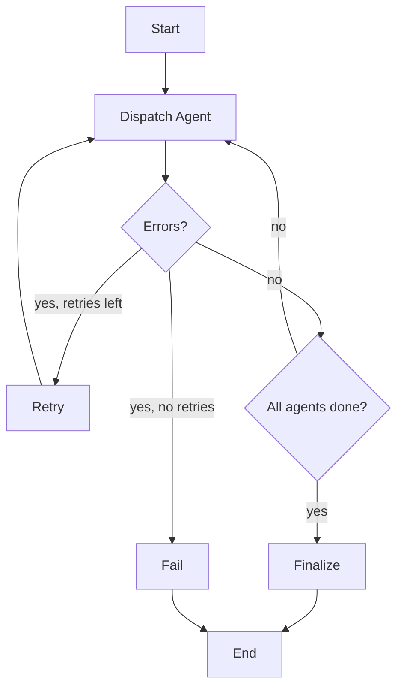
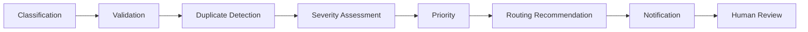

# CityFixAI — Agentic AI Workflow

## Overview

The backend exposes an 8-agent LangGraph workflow for civic issue triage.
Agents never mark a complaint as resolved without verified evidence and authorized human confirmation.

## Agents

1. Classification Agent - identifies civic issue type and category.
2. Validation Agent - checks report completeness and relevance.
3. Duplicate Detection Agent - finds similar reports by location, category, semantic similarity.
4. Severity Assessment Agent - calculates urgency and public impact.
5. Priority Agent - ranks issues for review.
6. Routing Recommendation Agent - suggests department/team (recommendation only; no government integration).
7. Notification Agent - generates status notifications.
## Workflow Diagram (Mermaid)

Agent execution order:

## Safety Rules

- Autonomous agents cannot mark a complaint as resolved.
- resolution_allowed is true only when human_approved=true, evidence is provided, and human_role=admin.
- Sensitive cases route to pending_human_review.

## Retry Handling

- Failed agents are retried up to max_retries (default 2).
- Each attempt is recorded in audit logs.

## API Endpoints

- POST /workflow/run
  - Body: { report, existing_reports, human_approved, evidence, human_role, max_retries }
  - Returns full workflow state including agent outputs, status, resolution_allowed, audit summary.

- GET /workflow/audit?workflow_run_id=&limit=
  - Returns persisted audit log entries.

## Example

curl -X POST http://localhost:8000/workflow/run -H 'Content-Type: application/json' -d '{"report":{"title":"Pothole near school","description":"Deep pothole causing accidents","category":"pothole","lat":40.7,"lng":-74.0}}'
8. Human Review Agent - requires administrator approval for sensitive decisions.